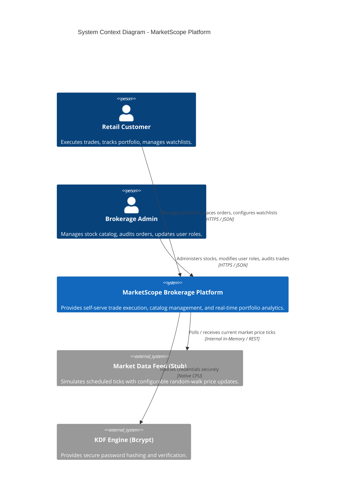
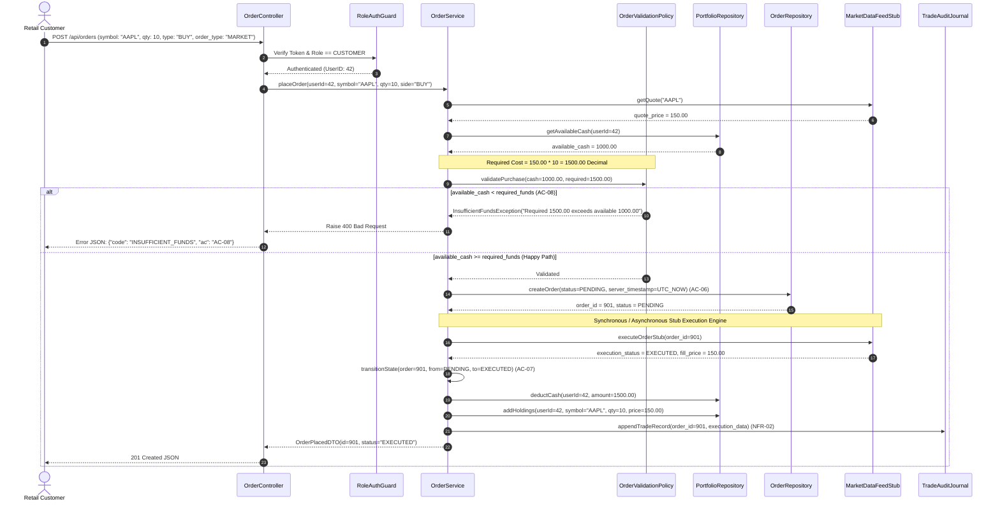
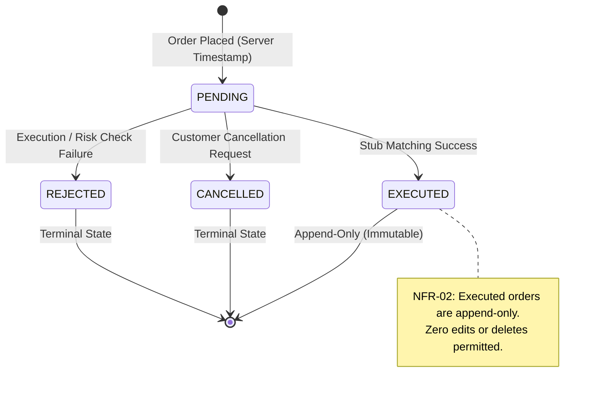
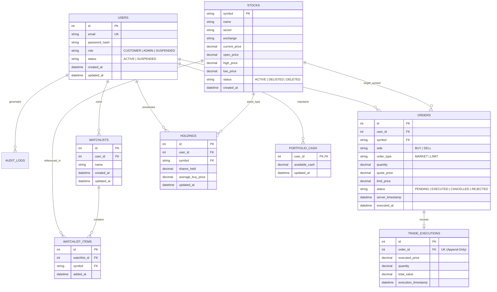

# Architecture Specification: MarketScope Platform

**Document ID:** ARCH-AINE-006  
**System:** MarketScope Stock Trading & Portfolio Analytics Platform  
**Compliance Standard:** AI-Native Engineering Rubric (BC-AINE-006)  

---

## 1. Architectural Philosophy & Layered Structure

MarketScope is engineered using a strict Clean Architecture / Layered Architecture pattern. Dependencies flow inward unidirectionally:

$$\text{Controllers} \longrightarrow \text{Services} \longrightarrow \text{Repositories} \longrightarrow \text{Domain Model}$$

```
+--------------------------------------------------------------------------+
|                        API / Controller Layer                            |
|  - Role-based Auth Guards (ADMIN / CUSTOMER / SUSPENDED)                |
|  - HTTP Request Validation (Pydantic / DTOs)                            |
|  - Structured Logging & Correlation ID Injection (NFR-04, NFR-06)        |
+--------------------------------------------------------------------------+
                                     |
                                     v
+--------------------------------------------------------------------------+
|                          Application Services                            |
|  - Use-Case Orchestration (UserService, OrderService, PortfolioService) |
|  - Atomic Database Transaction Management (AC-05)                        |
|  - Domain Policy Invocation & External Stub Coordination                 |
+--------------------------------------------------------------------------+
                                     |
                                     v
+--------------------------------------------------------------------------+
|                         Persistence / Repositories                       |
|  - CRUD Scaffolding & Query Interfaces                                   |
|  - Soft-Delete Filtering (AC-03: symbols never hard-deleted)             |
|  - Append-Only Trade Record Invariant (NFR-02)                           |
+--------------------------------------------------------------------------+
                                     |
                                     v
+--------------------------------------------------------------------------+
|                          Core Domain Layer                               |
|  - Pure Business Entities (User, Stock, Watchlist, Order, Holding)       |
|  - Value Objects (Price, Quantity, CashBalance, Ticker)                  |
|  - Fixed-Point Decimal Calculation Engine (NFR-01)                       |
|  - Domain Invariants & Policies (OrderValidationPolicy, PnLPolicy)       |
+--------------------------------------------------------------------------+
```

### Architectural Layer Invariants (Enforced via Automated ArchTests)
1. **Controllers** must never access Repositories or the Database directly; all calls must route through Services.
2. **Domain Models and Policies** must have zero external framework, HTTP, or database dependencies.
3. **Services** encapsulate transactional boundaries (`AC-05`).
4. **Repositories** enforce append-only invariants on executed orders and audit tables (`NFR-02`).

---

## 2. C4 Context Diagram



---

## 3. Order Placement & Execution Sequence Flow

The following sequence diagram illustrates the lifecycle of a BUY order, detailing validation against available cash (`AC-08`), transition to `PENDING` (`AC-06`), stub execution (`AC-07`), balance deduction, and append-only trade journaling (`NFR-02`).



---

## 4. Order State Machine Model

Order lifecycle enforcement (`AC-07`) strictly complies with the following finite state machine:



Any attempt to transition an order from `EXECUTED`, `CANCELLED`, or `REJECTED` to another state raises `InvalidOrderStateException` (`AC-07`).

---

## 5. Domain Invariants & Precision Rules

### 5.1 Fixed-Point Arithmetic (`NFR-01`)
All financial quantities ($P\&L$, prices, cash balances, quantities) are computed using exact decimal representations:
- **Python:** `decimal.Decimal` with rounding `ROUND_HALF_UP`.
- **Database:** `NUMERIC(18, 4)` for currency amounts; `NUMERIC(18, 6)` for fractional shares if applicable.
- **Rule:** Floating-point data types (`float`, `double`) are banned across domain logic, controllers, and persistence layers.

### 5.2 Append-Only Audit Integrity (`NFR-02`)
The persistence schema guarantees:
- Every execution produces a permanent row in `trade_executions`.
- Update and delete operations on `trade_executions` are blocked via database triggers or repository assertions.

### 5.3 Password Cryptography & Credentials (`NFR-03`)
- All user passwords are encrypted using `bcrypt` (work factor $\ge 12$).
- Plaintext passwords or decoded credentials are never logged, formatted into error messages, or returned in API responses.

### 5.4 Role Boundary Partitioning (`NFR-04`)
- Controllers use strict role decorators or middleware guards:
  - `/api/admin/*` $\rightarrow$ requires role `ADMIN`. Access by `CUSTOMER` or `SUSPENDED` results in `403 Forbidden`.
  - `/api/customer/*` $\rightarrow$ requires authenticated `CUSTOMER` or `ADMIN`.
- User suspension blocks all trading mutations.

### 5.5 Atomic Watchlist Engine (`AC-05`)
Watchlist mutations run inside atomic transactions. If any symbol in a bulk addition is invalid or delisted, the transaction rolls back completely and returns `WatchlistUpdateException`.

---

## 6. Database Entity-Relationship Architecture


